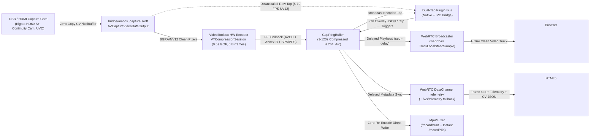
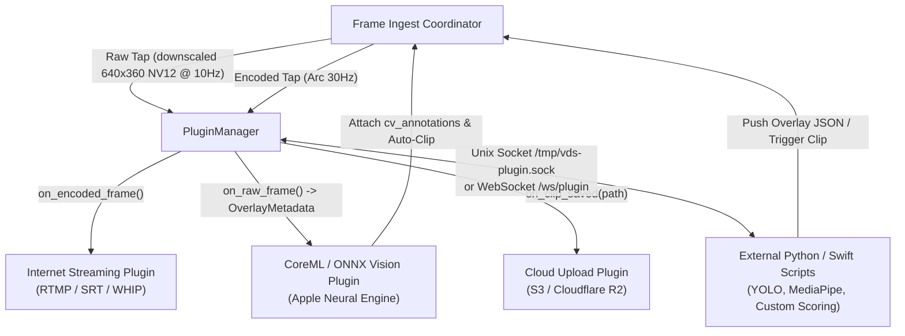

# Video Delay Server (Rust + Native Swift/VideoToolbox Edition) — Architecture & Implementation Plan

> **Target Architecture**: Standalone Greenfield Repository (`video-delay-server-rs/`)  
> **Target Platform**: Headless macOS (Apple Silicon `arm64` primary, extensible via `CaptureBackend` trait to Linux V4L2/GStreamer)  
> **Primary Goal**: Ultra-low CPU (`<10%`), flat bounded RAM (`~70–110 MB` at 120s delay), zero re-encoding multi-viewer WebRTC + MP4 recording, instant highlight clip export, clean pixels + client `<canvas>` overlay pipeline, extensible dual-layer plugin bus (Internet streaming & Computer Vision), and atomic zero-downtime headless updates.

---

## 1. Executive Summary & Architectural Decisions Matrix

All architectural trade-offs were evaluated against the existing Python 2.0 server (`aiortc` + OpenCV + FastAPI) and finalized into the following five core decisions:

| Design Axis | Finalized Decision | Why This Wins on Headless Apple Silicon |
| :--- | :--- | :--- |
| **1. Capture & Hardware Encoding** | **~150-line Native Swift Bridge** (`AVFoundation` + `VideoToolbox`) compiled via `build.rs` (`swiftc`) behind a cross-platform Rust `CaptureBackend` trait | Zero Homebrew/FFmpeg runtime dependencies; zero-copy `CVPixelBuffer → VTCompressionSession` on Apple Media Engine; clean trait boundary for Linux V4L2 later |
| **2. Delay Ring Buffer & Replay** | **Shared 1–120s GOP-Aligned H.264 Ring Buffer + Instant "Save Last N Seconds" Highlight Clip Export** (`POST /record/clip`) + Pause/Freeze | Encodes **once** at ingest (~70 MB RAM for 120s @ 5 Mbps); instant keyframe-snapped delay changes; `<50ms` highlight dumps straight from RAM to `.mp4` |
| **3. Video Pixels & Overlays** | **100% Clean Video Pixels + Synchronized HTML5 `<canvas>` Overlay Pipeline** via WebRTC DataChannel (`telemetry`) / WebSocket fallback | H.264 stream & `.mp4` stay clean and distortion-free; timestamp, FPS, camera name, and CV skeletons/boxes toggle live at 0% CPU re-encode cost (optional server burn-in on snapshot/clip export) |
| **4. Future Plugin Extensibility** | **Dual-Layer Plugin System**: In-process Rust `MediaPlugin` trait (Dual-Tap Raw + Encoded bus) **+** External Unix Socket / WebSocket IPC Bridge | High-throughput RTMP/SRT/WHIP streaming & CoreML Vision plugins run natively in Rust, while Python/Swift CV scripts attach via `/tmp/vds-plugin.sock` or `/ws/plugin` without recompiling Rust |
| **5. Deployment & Headless Ops** | **Standalone Greenfield Git Repository** (`video-delay-server-rs/`), single embedded binary (`rust-embed`), `./server.sh` + LaunchAgent + atomic rollback updater | Clean break from Python/venv fragility; single ~12 MB static binary with zero runtime interpreter dependencies and 10-second health-check auto-rollback |

### Projected Resource Comparison (720p @ 30 FPS, 120s Buffer, 2 WebRTC Viewers + MP4 Recording)

| Metric | Current Python Server (`aiortc` + OpenCV + `libx264`) | Planned Rust + Swift/VideoToolbox Server |
| :--- | :--- | :--- |
| **CPU Usage** | ~120%–395% CPU (2+ viewers re-encoding `libx264`) | **~6%–12% CPU** (Media Engine HW encode once; zero re-encode fan-out) |
| **Resident Memory (5s delay)** | ~700–940 MB RSS | **~35–45 MB RSS** |
| **Resident Memory (120s delay)** | ~3.5+ GB raw numpy frames (unbounded risk) | **~75–95 MB RSS** (compressed H.264 GOPs @ 5 Mbps) |
| **Threads** | 31–71 threads (OpenCV + PyAV pools) | **~6–10 threads** (Tokio async runtime + 1 Swift capture queue) |
| **Viewer Scaling Cost** | +1 software H.264 encoder per viewer | **~0.2% CPU per viewer** (RTP packetizer fan-out from shared `Arc<EncodedFrame>`) |
| **Runtime Dependencies** | Python 3.11, `myenv/`, OpenCV, PyAV, `aiortc` | **Zero** (single self-contained Mach-O `arm64` binary linking OS frameworks) |

---

## 2. End-to-End System Architecture & Dataflow

### 2.1 Zero-Copy Core Media Pipeline



### 2.2 Dual-Layer Plugin Bus Architecture



---

## 3. Standalone Greenfield Repository Layout

Create a new standalone Git repository (`video-delay-server-rs/`) completely separate from the Python codebase:

```text
video-delay-server-rs/
├── Cargo.toml                         # Rust workspace & dependencies
├── build.rs                           # Compiles Swift bridge via swiftc & links Apple frameworks
├── config.toml                        # Default runtime configuration (optional override)
├── server.sh                          # Unified CLI: build, start, stop, doctor, setup-power, update, rollback
├── .gitignore                         # Ignore target/, recordings/, thumbnails/, logs/, .bin_prev
│
├── bridge/
│   ├── macos_capture.h                # C-ABI contract between Rust and Swift
│   └── macos_capture.swift            # ~150-line AVFoundation + VideoToolbox + TCC + USB capture bridge
│
├── src/
│   ├── main.rs                        # CLI parser (--api, --host, --port, --list-cameras, --doctor), bootstrap, QR banner
│   ├── config.rs                      # Settings model, TOML persistence, runtime atomic state
│   ├── logger.rs                      # Tracing subscriber, daily/size-rotating videoserver.log & videoserver_error.log
│   │
│   ├── capture/
│   │   ├── mod.rs                     # Cross-platform CaptureBackend trait & FramePacket types
│   │   ├── macos.rs                   # Safe Rust FFI wrapper around libmacos_capture.a
│   │   ├── discovery.rs               # Smart camera priority (Elgato HD60 S+, Continuity name-pinning, UVC)
│   │   └── test_pattern.rs            # Pure-Rust synthetic SMPTE bars + moving clock H.264/raw generator
│   │
│   ├── pipeline/
│   │   ├── mod.rs                     # StreamManager coordinator (start/stop/restart/recover/switch_camera)
│   │   ├── ring_buffer.rs             # GOP-aligned H.264 ring buffer, dynamic delay snap, pause, clip slicing
│   │   ├── metrics.rs                 # Measured cap/tx/rtc FPS, stage latency, black/frozen frame watchdog
│   │   └── mp4_muxer.rs               # Zero-re-encode AVCC MP4 recorder, instant highlight clip writer, thumbnailer
│   │
│   ├── net/
│   │   ├── mod.rs                     # LAN IP detection & QR terminal printer
│   │   ├── webrtc.rs                  # webrtc-rs peer manager, H.264 RTP fan-out, DataChannel telemetry, watchdogs
│   │   └── api.rs                     # Axum router, REST parity + new endpoints, rust-embed static asset server
│   │
│   ├── diagnostics/
│   │   ├── mod.rs                     # 6-point headless checks (TCC, arm64/Rosetta, USB 2/3 speed, health, disk, sudo)
│   │   └── power.rs                   # Graceful Mac restart/shutdown (flush MP4/peers -> sudo /sbin/shutdown -> osascript)
│   │
│   ├── plugins/
│   │   ├── mod.rs                     # MediaPlugin trait, Dual-Tap dispatcher, OverlayAnnotation schema
│   │   ├── ipc_bridge.rs              # Unix Domain Socket (/tmp/vds-plugin.sock) & WebSocket (/ws/plugin) server
│   │   ├── rtmp_whip.rs               # Reference Plugin 1: Internet streaming (RTMP / SRT / WHIP)
│   │   ├── vision_coreml.rs           # Reference Plugin 2: CoreML / ONNX Apple Neural Engine vision + auto-clip
│   │   └── s3_upload.rs               # Reference Plugin 3: Background S3 / R2 clip uploader
│   │
│   └── updater.rs                     # Self-update controller: GitHub Release download / local build + atomic swap + 10s rollback
│
├── static/                            # Embedded at compile time via rust-embed
│   ├── index.html                     # Control panel + clean <video> + synchronized HiDPI <canvas> overlay engine
│   ├── gallery.html                   # Recordings & Highlight Clips gallery with delete & download
│   └── app.css                        # Responsive mobile-first UI styles
│
├── plugins/
│   └── examples/
│       └── python_cv_overlay.py       # Minimal Python script demonstrating external IPC boxes/skeletons & clip triggers
│
└── tests/
    ├── ring_buffer_tests.rs           # GOP snap, dynamic resize, 120s bound, instant clip slicing tests
    ├── mp4_muxer_tests.rs             # Valid moov/avcC generation & empty-file cleanup tests
    └── api_parity_tests.rs            # Axum tower::ServiceExt tests for every REST endpoint
```

---

## 4. `Cargo.toml` & `build.rs` Specification

### 4.1 `Cargo.toml`

```toml
[package]
name = "video-delay-server"
version = "3.0.0"
edition = "2021"
build = "build.rs"
description = "Ultra-low-CPU Rust + VideoToolbox live video delay server with highlight clipping and plugin bus"

[features]
default = ["plugin-ipc", "plugin-whip", "plugin-s3"]
plugin-ipc = []
plugin-whip = []
plugin-rtmp = ["dep:rml_rtmp"]
plugin-coreml = []          # Optional CoreML/ORT vision pipeline
plugin-s3 = ["dep:reqwest"]

[dependencies]
# Async runtime & Web server
tokio = { version = "1.40", features = ["full"] }
axum = { version = "0.7", features = ["ws", "macros"] }
tower-http = { version = "0.5", features = ["cors", "fs", "trace"] }
rust-embed = "8.5"
mime_guess = "2.0"

# WebRTC (pure Rust, zero Python/aiortc overhead)
webrtc = "0.11"

# Zero-re-encode MP4 muxing & high-speed buffers
mp4 = "0.14"
bytes = "1.7"
arc-swap = "1.7"
parking_lot = "0.12"

# Serialization & Config
serde = { version = "1.0", features = ["derive"] }
serde_json = "1.0"
toml = "0.8"

# Logging & Diagnostics
tracing = "0.1"
tracing-subscriber = { version = "0.3", features = ["env-filter", "fmt"] }
tracing-appender = "0.2"
sysinfo = "0.31"
clap = { version = "4.5", features = ["derive"] }

# Networking, QR banner & On-demand JPEG snapshots
local-ip-address = "0.6"
qrcode = "0.14"
image = { version = "0.25", default-features = false, features = ["jpeg"] }
openh264 = "0.6"          # Used ONLY for on-demand 1-frame IDR decode on /snapshot & clip thumbnail
chrono = { version = "0.4", features = ["serde"] }
uuid = { version = "1.10", features = ["v4"] }

# Optional Plugin Dependencies
rml_rtmp = { version = "0.8", optional = true }
reqwest = { version = "0.12", optional = true, default-features = false, features = ["rustls-tls", "json", "stream"] }

[profile.release]
opt-level = 3
lto = "thin"
codegen-units = 1
strip = "symbols"
```

> **Note on `openh264` Usage**: `VTCompressionSession` handles 100% of continuous 30–60 FPS video encoding in hardware on Apple Silicon. `openh264`'s tiny decoder is invoked **only once per snapshot request (`GET /snapshot`) or clip thumbnail** to decode a single IDR keyframe to RGB JPEG, avoiding linking heavy FFmpeg C libraries. (Alternatively, `VTDecompressionSession` inside the Swift bridge can decode that single IDR in hardware with zero extra crates!)

### 4.2 `build.rs`

```rust
use std::env;
use std::path::PathBuf;
use std::process::Command;

fn main() {
    println!("cargo:rerun-if-changed=bridge/macos_capture.swift");
    println!("cargo:rerun-if-changed=bridge/macos_capture.h");

    #[cfg(target_os = "macos")]
    {
        let out_dir = PathBuf::from(env::var("OUT_DIR").unwrap());
        let obj_path = out_dir.join("macos_capture.o");
        let lib_path = out_dir.join("libmacos_capture.a");

        // Compile ~150-line Swift bridge directly using Apple's built-in swiftc (no Xcode project needed)
        let status = Command::new("swiftc")
            .args([
                "-O",
                "-parse-as-library",
                "-emit-object",
                "-target", "arm64-apple-macosx13.0",
                "-import-objc-header", "bridge/macos_capture.h",
                "-o", obj_path.to_str().unwrap(),
                "bridge/macos_capture.swift",
            ])
            .status()
            .expect("Failed to invoke swiftc — install CommandLineTools via `xcode-select --install`");
        assert!(status.success(), "swiftc compilation of macos_capture.swift failed");

        let ar_status = Command::new("ar")
            .args(["rcs", lib_path.to_str().unwrap(), obj_path.to_str().unwrap()])
            .status()
            .expect("Failed to run ar");
        assert!(ar_status.success(), "ar static archive creation failed");

        println!("cargo:rustc-link-search=native={}", out_dir.display());
        println!("cargo:rustc-link-lib=static=macos_capture");

        // Link Apple system frameworks
        for fw in ["AVFoundation", "CoreMedia", "CoreVideo", "VideoToolbox", "Foundation", "CoreGraphics"] {
            println!("cargo:rustc-link-lib=framework={fw}");
        }
        // Swift runtime compatibility library paths (Command Line Tools / macOS)
        println!("cargo:rustc-link-arg=-Wl,-rpath,/usr/lib/swift");
    }
}
```

---

## 5. Phase 1: `CaptureBackend` Trait & ~150-Line Swift/VideoToolbox Bridge

### 5.1 Rust `CaptureBackend` Trait (`src/capture/mod.rs`)

Abstracting macOS behind `CaptureBackend` makes adding Linux (`v4l2` + `openh264`/VAAPI) a drop-in module while keeping zero overhead on macOS:

```rust
use bytes::Bytes;

#[derive(Debug, Clone, serde::Serialize)]
pub struct CameraDeviceInfo {
    pub index: i32,
    pub unique_id: String,
    pub name: String,
    pub is_capture_card: bool,
    pub is_continuity: bool,
    pub is_default: bool,
}

#[derive(Debug, Clone)]
pub struct RawTapFrame {
    pub seq: u64,
    pub width: u32,
    pub height: u32,
    pub timestamp_us: i64,
    pub luma_mean: f32,          // Computed in ~0.05ms in Swift/Rust for black-frame detection
    pub nv12_or_bgra: Bytes,     // Downscaled 640x360 frame for CV plugins (5-10 Hz)
}

#[derive(Debug, Clone)]
pub struct EncodedPacket {
    pub seq: u64,
    pub pts_us: i64,
    pub capture_unix_ms: u64,
    pub is_keyframe: bool,
    pub width: u32,
    pub height: u32,
    pub sps: Option<Bytes>,      // Populated on IDR keyframes
    pub pps: Option<Bytes>,      // Populated on IDR keyframes
    pub avcc_data: Bytes,        // 4-byte length-prefixed NALUs (ready for MP4 muxer)
    pub annexb_data: Bytes,      // 00 00 00 01 prefixed NALUs (ready for WebRTC/RTMP/SRT)
    pub luma_mean: f32,          // Clean pixel brightness metric
    pub frame_hash: u64,         // Fast 64-byte center-row hash for frozen-frame detection
}

pub trait CaptureBackend: Send + Sync {
    fn list_devices(&self) -> Vec<CameraDeviceInfo>;
    fn check_tcc_permission(&self) -> i32; // 0=not_determined, 1=restricted, 2=denied, 3=authorized
    fn start(
        &self,
        device_index: i32,
        width: u32,
        height: u32,
        fps: u32,
        bitrate_bps: u32,
        gop_frames: u32,
        raw_tap_stride: u32,     // e.g. emit raw tap every Nth frame (3 = 10Hz @ 30fps, 0 = disabled)
        on_encoded: Box<dyn Fn(EncodedPacket) + Send + Sync>,
        on_raw_tap: Box<dyn Fn(RawTapFrame) + Send + Sync>,
    ) -> Result<String, String>; // Returns resolved device name
    fn stop(&self);
    fn force_idr(&self);
}
```

### 5.2 Smart Camera Discovery & Continuity Camera Name-Pinning (`src/capture/discovery.rs`)

Matches the exact selection hierarchy built in the Python server, upgraded with `AVCaptureDevice` hardware metadata:

1. **Explicit Selection (`cam_index` + `cam_name`)**: If `cam_name` was previously persisted (e.g. `"iPhone Camera"`), verify whether `list_devices()[cam_index].name == cam_name`. If iOS Continuity Camera shifted device indices upon reconnect, automatically scan for matching `cam_name` and bind to the updated index!
2. **Primary Capture Card Priority**: Case-insensitive match against `["hd60 s+", "hd60", "game capture", "elgato", "cam link", "capture", "hdmi"]`.
3. **External UVC Webcam**: First external USB camera (`unique_id` / non-built-in).
4. **Built-in Fallback**: Index `0` (FaceTime HD / first available device), or **Synthetic Test Pattern** if zero cameras exist so the server boots cleanly headless.

### 5.3 C-ABI Header (`bridge/macos_capture.h`)

```c
#ifndef MACOS_CAPTURE_H
#define MACOS_CAPTURE_H

#include <stdint.h>
#include <stdbool.h>

typedef void (*VdsEncodedCallback)(
    void* ctx,
    uint64_t seq,
    int64_t pts_us,
    bool is_keyframe,
    uint32_t width,
    uint32_t height,
    const uint8_t* avcc_ptr, uint32_t avcc_len,
    const uint8_t* sps_ptr,  uint32_t sps_len,
    const uint8_t* pps_ptr,  uint32_t pps_len,
    float luma_mean,
    uint64_t frame_hash
);

typedef void (*VdsRawTapCallback)(
    void* ctx,
    uint64_t seq,
    int64_t pts_us,
    uint32_t width,
    uint32_t height,
    const uint8_t* bgra_ptr,
    uint32_t bgra_len,
    float luma_mean
);

// Device enumeration: returns JSON string (caller must free via vds_free_string)
char* vds_list_cameras_json(void);
void  vds_free_string(char* ptr);
int32_t vds_tcc_status(void);

// Lifecycle
bool vds_capture_start(
    int32_t device_index,
    uint32_t width,
    uint32_t height,
    uint32_t fps,
    uint32_t bitrate_bps,
    uint32_t gop_frames,
    uint32_t raw_tap_stride,
    void* ctx,
    VdsEncodedCallback on_encoded,
    VdsRawTapCallback on_raw_tap,
    char* out_name_buf,
    int32_t out_name_cap
);
void vds_capture_stop(void);
void vds_capture_force_idr(void);

#endif
```

### 5.4 ~150-Line Swift Bridge (`bridge/macos_capture.swift`)

Notice **zero pixels are modified** here (`CVPixelBuffer` passes directly into `VTCompressionSessionEncodeFrame` via DMA/IOSurface):

```swift
import Foundation
import AVFoundation
import VideoToolbox
import CoreVideo
import CoreMedia
import CoreImage

private final class CaptureController: NSObject, AVCaptureVideoDataOutputSampleBufferDelegate {
    static let shared = CaptureController()

    private let queue = DispatchQueue(label: "vds.capture.queue", qos: .userInteractive)
    private var session: AVCaptureSession?
    private var vtSession: VTCompressionSession?
    private let ciContext = CIContext(options: [.useSoftwareRenderer: false])

    private var seq: UInt64 = 0
    private var gopFrames: UInt32 = 15
    private var rawTapStride: UInt32 = 3
    private var targetWidth: UInt32 = 1280
    private var targetHeight: UInt32 = 720
    private var forceNextIdr = true

    private var ctx: UnsafeMutableRawPointer?
    private var onEncoded: VdsEncodedCallback?
    private var onRawTap: VdsRawTapCallback?

    static func discoverDevices() -> [AVCaptureDevice] {
        var types: [AVCaptureDevice.DeviceType] = [.builtInWideAngleCamera]
        if #available(macOS 14.0, *) {
            types.append(.external)
            types.append(.continuityCamera)
        } else {
            types.append(.externalUnknown)
        }
        return AVCaptureDevice.DiscoverySession(
            deviceTypes: types, mediaType: .video, position: .unspecified
        ).devices.sorted { $0.uniqueID < $1.uniqueID }
    }

    func start(
        index: Int32, width: UInt32, height: UInt32, fps: UInt32,
        bitrate: UInt32, gop: UInt32, rawStride: UInt32,
        ctx: UnsafeMutableRawPointer?, encCb: VdsEncodedCallback?, rawCb: VdsRawTapCallback?
    ) -> String? {
        stop()
        let devices = Self.discoverDevices()
        guard index >= 0 && Int(index) < devices.count else { return nil }
        let device = devices[Int(index)]

        self.targetWidth = width
        self.targetHeight = height
        self.gopFrames = max(5, gop)
        self.rawTapStride = rawStride
        self.ctx = ctx
        self.onEncoded = encCb
        self.onRawTap = rawCb
        self.seq = 0
        self.forceNextIdr = true

        guard configureVideoToolbox(width: width, height: height, fps: fps, bitrate: bitrate, gop: gop) else {
            return nil
        }

        let capSession = AVCaptureSession()
        capSession.beginConfiguration()
        if let input = try? AVCaptureDeviceInput(device: device), capSession.canAddInput(input) {
            capSession.addInput(input)
        } else {
            return nil
        }

        // Clamp camera frame rate cleanly
        try? device.lockForConfiguration()
        device.activeVideoMinFrameDuration = CMTime(value: 1, timescale: Int32(fps))
        device.unlockForConfiguration()

        let output = AVCaptureVideoDataOutput()
        output.videoSettings = [
            kCVPixelBufferPixelFormatTypeKey as String: kCVPixelFormatType_420YpCbCr8BiPlanarVideoRange
        ]
        output.alwaysDiscardsLateVideoFrames = true
        output.setSampleBufferDelegate(self, queue: queue)
        if capSession.canAddOutput(output) { capSession.addOutput(output) }
        capSession.commitConfiguration()

        self.session = capSession
        capSession.startRunning()
        return device.localizedName
    }

    func stop() {
        session?.stopRunning()
        session = nil
        if let vt = vtSession {
            VTCompressionSessionCompleteFrames(vt, untilPresentationTimeStamp: .invalid)
            VTCompressionSessionInvalidate(vt)
            vtSession = nil
        }
    }

    func requestIDR() { queue.async { self.forceNextIdr = true } }

    private func configureVideoToolbox(width: UInt32, height: UInt32, fps: UInt32, bitrate: UInt32, gop: UInt32) -> Bool {
        var vt: VTCompressionSession?
        let encoderSpec: [String: Any] = [
            kVTVideoEncoderSpecification_EnableHardwareAcceleratedVideoEncoder as String: true
        ]
        let status = VTCompressionSessionCreate(
            allocator: nil,
            width: Int32(width),
            height: Int32(height),
            codecType: kCMVideoCodecType_H264,
            encoderSpecification: encoderSpec as CFDictionary,
            imageBufferAttributes: nil,
            compressedDataAllocator: nil,
            outputCallback: vtOutputCallback,
            refcon: Unmanaged.passUnretained(self).toOpaque(),
            compressionSessionOut: &vt
        )
        guard status == noErr, let vt else { return false }
        VTSessionSetProperty(vt, key: kVTCompressionPropertyKey_RealTime, value: kCFBooleanTrue)
        VTSessionSetProperty(vt, key: kVTCompressionPropertyKey_ProfileLevel, value: kVTProfileLevel_H264_High_AutoLevel)
        VTSessionSetProperty(vt, key: kVTCompressionPropertyKey_AllowFrameReordering, value: kCFBooleanFalse)
        VTSessionSetProperty(vt, key: kVTCompressionPropertyKey_MaxKeyFrameInterval, value: NSNumber(value: gop))
        VTSessionSetProperty(vt, key: kVTCompressionPropertyKey_ExpectedFrameRate, value: NSNumber(value: fps))
        VTSessionSetProperty(vt, key: kVTCompressionPropertyKey_AverageBitRate, value: NSNumber(value: bitrate))
        VTCompressionSessionPrepareToEncodeFrames(vt)
        self.vtSession = vt
        return true
    }

    func captureOutput(_ output: AVCaptureOutput, didOutput sampleBuffer: CMSampleBuffer, from connection: AVCaptureConnection) {
        guard let vt = vtSession, let pb = CMSampleBufferGetImageBuffer(sampleBuffer) else { return }
        seq += 1
        let pts = CMSampleBufferGetPresentationTimeStamp(sampleBuffer)
        let ptsUs = Int64(CMTimeGetSeconds(pts) * 1_000_000.0)

        // Lightweight brightness + center-line hash on clean Y-plane (<0.03ms) for frozen/black check
        let (luma, hash) = sampleLumaAndHash(pb)

        var frameProps: [String: Any] = [:]
        if forceNextIdr || (seq % UInt64(gopFrames) == 1) {
            frameProps[kVTEncodeFrameOptionKey_ForceKeyFrame as String] = true
            forceNextIdr = false
        }

        // Pack per-frame telemetry in refcon tuple pointer (luma, hash, ptsUs, seq) via unsafe heap box
        let meta = UnsafeMutablePointer<(UInt64, Int64, Float, UInt64)>.allocate(capacity: 1)
        meta.initialize(to: (seq, ptsUs, luma, hash))

        VTCompressionSessionEncodeFrame(
            vt, imageBuffer: pb, presentationTimeStamp: pts,
            duration: CMTime(value: 1, timescale: 30),
            frameProperties: frameProps.isEmpty ? nil : frameProps as CFDictionary,
            sourceFrameRefcon: meta, infoFlagsOut: nil
        )

        // Optional throttled downscaled raw tap (5-10 Hz) for CV plugins
        if rawTapStride > 0, let rawCb = onRawTap, (seq % UInt64(rawTapStride) == 0) {
            emitDownscaledRawTap(pb: pb, seq: seq, ptsUs: ptsUs, luma: luma, cb: rawCb)
        }
    }

    private func sampleLumaAndHash(_ pb: CVPixelBuffer) -> (Float, UInt64) {
        CVPixelBufferLockBaseAddress(pb, .readOnly)
        defer { CVPixelBufferUnlockBaseAddress(pb, .readOnly) }
        guard let yPtr = CVPixelBufferGetBaseAddressOfPlane(pb, 0) else { return (128.0, 0) }
        let stride = CVPixelBufferGetBytesPerRowOfPlane(pb, 0)
        let h = CVPixelBufferGetHeightOfPlane(pb, 0)
        let w = CVPixelBufferGetWidthOfPlane(pb, 0)
        let buf = yPtr.assumingMemoryBound(to: UInt8.self)
        var sum: UInt64 = 0
        var hash: UInt64 = 14695981039346656037
        let samples = 64
        let midRow = (h / 2) * stride
        for i in 0..<samples {
            let yVal = buf[(i * h / samples) * stride + (i * w / samples)]
            sum += UInt64(yVal)
            hash = (hash ^ UInt64(buf[midRow + (i * w / samples)])) &* 1099511628211
        }
        return (Float(sum) / Float(samples), hash)
    }

    private func emitDownscaledRawTap(pb: CVPixelBuffer, seq: UInt64, ptsUs: Int64, luma: Float, cb: VdsRawTapCallback) {
        let tw = 640, th = 360
        let img = CIImage(cvPixelBuffer: pb)
        let sx = CGFloat(tw) / img.extent.width
        let sy = CGFloat(th) / img.extent.height
        let scaled = img.transformed(by: CGAffineTransform(scaleX: sx, y: sy))
        var bytes = [UInt8](repeating: 0, count: tw * th * 4)
        ciContext.render(scaled, toBitmap: &bytes, rowBytes: tw * 4,
                         bounds: CGRect(x: 0, y: 0, width: tw, height: th),
                         format: .RGBA8, colorSpace: CGColorSpaceCreateDeviceRGB())
        bytes.withUnsafeBufferPointer { ptr in
            cb(self.ctx, seq, ptsUs, UInt32(tw), UInt32(th), ptr.baseAddress, UInt32(bytes.count), luma)
        }
    }

    fileprivate func handleEncoded(status: OSStatus, refcon: UnsafeMutableRawPointer?, sampleBuffer: CMSampleBuffer?) {
        guard let refcon else { return }
        let meta = refcon.assumingMemoryBound(to: (UInt64, Int64, Float, UInt64).self)
        let (fSeq, fPtsUs, fLuma, fHash) = meta.move()
        meta.deallocate()

        guard status == noErr, let sb = sampleBuffer,
              let block = CMSampleBufferGetDataBuffer(sb),
              let encCb = onEncoded else { return }

        var isKeyframe = false
        if let arr = CMSampleBufferGetSampleAttachmentsArray(sb, createIfNecessary: false) as? [[CFString: Any]],
           let first = arr.first {
            isKeyframe = !(first[kCMSampleAttachmentKey_NotSync] as? Bool ?? false)
        }

        var spsData = Data(), ppsData = Data()
        if isKeyframe, let fmt = CMSampleBufferGetFormatDescription(sb) {
            var spsPtr: UnsafePointer<UInt8>?, spsLen = 0
            var ppsPtr: UnsafePointer<UInt8>?, ppsLen = 0
            CMVideoFormatDescriptionGetH264ParameterSetAtIndex(fmt, parameterSetIndex: 0, parameterSetPointerOut: &spsPtr, parameterSetSizeOut: &spsLen, parameterSetCountOut: nil, nalUnitHeaderLengthOut: nil)
            CMVideoFormatDescriptionGetH264ParameterSetAtIndex(fmt, parameterSetIndex: 1, parameterSetPointerOut: &ppsPtr, parameterSetSizeOut: &ppsLen, parameterSetCountOut: nil, nalUnitHeaderLengthOut: nil)
            if let s = spsPtr { spsData = Data(bytes: s, count: spsLen) }
            if let p = ppsPtr { ppsData = Data(bytes: p, count: ppsLen) }
        }

        var totalLen = 0
        var dataPtr: UnsafeMutablePointer<Int8>?
        CMBlockBufferGetDataPointer(block, atOffset: 0, lengthAtOffsetOut: nil, totalLengthOut: &totalLen, dataPointerOut: &dataPtr)
        guard let raw = dataPtr else { return }

        let avcc = Data(bytes: raw, count: totalLen)
        avcc.withUnsafeBytes { avccBuf in
            spsData.withUnsafeBytes { spsBuf in
                ppsData.withUnsafeBytes { ppsBuf in
                    encCb(
                        self.ctx, fSeq, fPtsUs, isKeyframe, targetWidth, targetHeight,
                        avccBuf.baseAddress?.assumingMemoryBound(to: UInt8.self), UInt32(avcc.count),
                        spsBuf.baseAddress?.assumingMemoryBound(to: UInt8.self), UInt32(spsData.count),
                        ppsBuf.baseAddress?.assumingMemoryBound(to: UInt8.self), UInt32(ppsData.count),
                        fLuma, fHash
                    )
                }
            }
        }
    }
}

private let vtOutputCallback: VTCompressionOutputCallback = { outputCtx, sourceFrameRefcon, status, _, sampleBuffer in
    guard let outputCtx else { return }
    Unmanaged<CaptureController>.fromOpaque(outputCtx).takeUnretainedValue()
        .handleEncoded(status: status, refcon: sourceFrameRefcon, sampleBuffer: sampleBuffer)
}

@_cdecl("vds_tcc_status")
public func vds_tcc_status() -> Int32 {
    Int32(AVCaptureDevice.authorizationStatus(for: .video).rawValue)
}

@_cdecl("vds_list_cameras_json")
public func vds_list_cameras_json() -> UnsafeMutablePointer<CChar>? {
    let list = CaptureController.discoverDevices().enumerated().map { idx, d -> [String: Any] in
        [
            "index": idx,
            "unique_id": d.uniqueID,
            "name": d.localizedName,
            "is_continuity": d.localizedName.lowercased().contains("iphone") || d.localizedName.lowercased().contains("continuity"),
        ]
    }
    guard let json = try? JSONSerialization.data(withJSONObject: list),
          let str = String(data: json, encoding: .utf8) else { return nil }
    return strdup(str)
}

@_cdecl("vds_free_string")
public func vds_free_string(ptr: UnsafeMutablePointer<CChar>?) { free(ptr) }

@_cdecl("vds_capture_start")
public func vds_capture_start(
    device_index: Int32, width: UInt32, height: UInt32, fps: UInt32,
    bitrate_bps: UInt32, gop_frames: UInt32, raw_tap_stride: UInt32,
    ctx: UnsafeMutableRawPointer?, on_encoded: VdsEncodedCallback?, on_raw_tap: VdsRawTapCallback?,
    out_name_buf: UnsafeMutablePointer<CChar>?, out_name_cap: Int32
) -> Bool {
    guard let name = CaptureController.shared.start(
        index: device_index, width: width, height: height, fps: fps,
        bitrate: bitrate_bps, gop: gop_frames, rawStride: raw_tap_stride,
        ctx: ctx, encCb: on_encoded, rawCb: on_raw_tap
    ) else { return false }
    if let buf = out_name_buf, out_name_cap > 0 {
        _ = name.withCString { strncpy(buf, $0, Int(out_name_cap) - 1) }
        buf[Int(out_name_cap) - 1] = 0
    }
    return true
}

@_cdecl("vds_capture_stop")
public func vds_capture_stop() { CaptureController.shared.stop() }

@_cdecl("vds_capture_force_idr")
public func vds_capture_force_idr() { CaptureController.shared.requestIDR() }
```

---

## 6. Phase 2: Lock-Free GOP Ring Buffer, Dynamic Delay & Instant Highlight Clip Export

### 6.1 Core Data Structures (`src/pipeline/ring_buffer.rs`)

Storing H.264 frames instead of uncompressed BGRA arrays slashes RAM usage by **50×** while enabling instant non-destructive MP4 exports:

```rust
use bytes::Bytes;
use std::collections::VecDeque;
use std::sync::Arc;

#[derive(Debug, Clone, serde::Serialize, serde::Deserialize)]
pub struct OverlayBox {
    pub label: String,
    pub confidence: f32,
    pub x: f32,      // Normalized [0.0..1.0]
    pub y: f32,
    pub w: f32,
    pub h: f32,
    pub color: String,
}

#[derive(Debug, Clone, serde::Serialize, serde::Deserialize)]
pub struct PoseSkeleton {
    pub id: u32,
    pub keypoints: Vec<[f32; 3]>, // [norm_x, norm_y, conf]
}

#[derive(Debug, Clone, Default, serde::Serialize, serde::Deserialize)]
pub struct CvOverlayPayload {
    pub source_plugin: String,
    pub boxes: Vec<OverlayBox>,
    pub skeletons: Vec<PoseSkeleton>,
}

#[derive(Debug, Clone)]
pub struct EncodedFrame {
    pub seq: u64,
    pub pts_us: i64,
    pub capture_unix_ms: u64,
    pub is_keyframe: bool,
    pub width: u32,
    pub height: u32,
    pub sps: Option<Bytes>,
    pub pps: Option<Bytes>,
    pub avcc_data: Bytes,          // Ready for MP4 mdat
    pub annexb_data: Bytes,        // Ready for WebRTC / RTMP / WHIP (includes SPS+PPS on keyframe)
    pub camera_name: Arc<str>,
    pub measured_fps: f32,
    pub cv_overlay: Option<Arc<CvOverlayPayload>>,
}

pub struct GopRingBuffer {
    frames: VecDeque<Arc<EncodedFrame>>,
    max_capacity_frames: usize,    // Hard cap: 120s * 60fps = 7200 frames (~70–95 MB total)
    delay_seconds: u32,            // 1..=120
    paused: bool,
    paused_seq: Option<u64>,
    last_emitted_seq: u64,
    active_idr_seq: Option<u64>,   // Tracks IDR boundary for clean keyframe snapping
}
```

### 6.2 Keyframe-Safe Dynamic Delay & Pause Algorithms

1. **Ingestion (`push(frame)`)**:
   - Push `Arc<EncodedFrame>` to back of `VecDeque`.
   - Evict from front while `frames.len() > max_capacity_frames`, **guaranteeing eviction stops on the next IDR boundary** only when trimming old GOP tails.
   - Maintain a sliding window of CV overlay metadata by `seq` so async CV inference (which may finish 15–40ms after capture) attaches cleanly to the live/delayed frame stream **before** the delayed playhead reaches it! (Because the stream is delayed by $\ge 1\text{s}$, CV models running in 20–50ms have *plenty* of lookahead time to annotate frames synchronously before viewers ever see them!)
2. **Delayed Playhead Selection (`pop_delayed_step(target_fps)`)**:
   - Target delayed index: `target_idx = frames.len().saturating_sub(delay_seconds as usize * target_fps as usize)`.
   - If `paused == true`:
     - Freeze `paused_seq` on initial pause and emit keepalive metadata (`paused: true`) without advancing RTP video samples (or emit frame-hold at 2 Hz if browser decoder stalls).
     - **Important**: Ingest keeps filling the ring buffer during pause (or freezes playhead offset relative to wall-clock depending on mode) until resumed.
   - **Dynamic Delay Jump Snapping (`set_delay(new_sec)`)**:
     - Whenever `delay_seconds` changes or a new WebRTC viewer joins, snap `last_emitted_seq` backward/forward to the **nearest IDR keyframe (`is_keyframe == true`)** within $\le 0.5\text{s}$ of the target timestamp. Result: zero green artifacts or gray macroblocking when dragging the delay slider from 5s → 45s.
3. **Instant "Save Last N Seconds" Highlight Clip Export (`export_last_seconds(n_sec: u32) -> Vec<Arc<EncodedFrame>>`)**:
   - Reads the `Arc<EncodedFrame>` slice `[now - n_sec .. now]` directly from `frames`.
   - Scans backward by at most 1 GOP ($\le 0.5\text{s}$) so the slice **always begins on an IDR keyframe** with valid `sps` & `pps`.
   - Hands the `Vec<Arc<EncodedFrame>>` off-thread to `Mp4Muxer::write_clip_instant()` which writes all frames straight to `/recordings/clip_YYYYMMDD_HHMMSS.mp4` in **< 50 milliseconds**, generates its JPEG thumbnail, and returns the URL immediately!

---

## 7. Phase 3: Multi-Viewer WebRTC Broadcaster & Clean-Video + Synchronized `<canvas>` Pipeline

### 7.1 Zero-Re-Encode WebRTC Fan-Out (`src/net/webrtc.rs`)

- **Shared Track Architecture**:
  - Uses a `tokio::sync::broadcast::Sender<Arc<EncodedFrame>>` fed by the delayed playhead ticker (`tokio::time::interval` paced to the stream's measured cadence).
  - For every connected browser peer (`RTCPeerConnection`), spawn a lightweight Tokio task reading from the broadcast channel:
    - Waits until `frame.is_keyframe == true` on initial connect or after receiving an RTCP `PLI` / `FIR` packet from that peer (triggering `capture.force_idr()` if live, or immediately serving the latest IDR from the ring buffer).
    - Calls `video_track.write_sample(&Sample { data: frame.annexb_data.clone(), duration })`. Because `Bytes` is reference-counted (`Arc`), **zero byte copies** occur across 1 or 50 connected iPads/phones.
- **Peer Watchdog & Auto-Cleanup**:
  - Every `RTCPeerConnection` registers an `on_peer_connection_state_change` handler + 15-second dead-peer reaper (`Failed | Closed | Disconnected > 5s`), immediately dropping the broadcast receiver and closing the peer connection so memory and listener counts return strictly to `0` on disconnect.

### 7.2 Synchronized Clean-Video Telemetry + `<canvas>` Overlay Protocol

Because video pixels remain 100% clean, overlays are drawn crisply at native Retina DPI in the browser on top of `<video>` via an aligned `<canvas id="overlayCanvas">`:

1. **Transport**:
   - Each `RTCPeerConnection` opens an unreliable/ordered WebRTC DataChannel named `"telemetry"` alongside the H.264 video track (with automatic fallback to `GET /ws/telemetry` WebSocket if a browser restricts DataChannels).
2. **Per-Frame JSON Message** (emitted at delayed playhead cadence, ~200 bytes when CV boxes are empty):

```json
{
  "seq": 14820,
  "capture_unix_ms": 1764328200123,
  "fps": 29.9,
  "camera_name": "Elgato HD60 S+",
  "delay_seconds": 5,
  "paused": false,
  "show_timestamp": true,
  "show_fps": true,
  "show_camera_name": false,
  "cv": {
    "source_plugin": "coreml_yolov8_pose",
    "boxes": [
      { "label": "athlete", "confidence": 0.94, "x": 0.41, "y": 0.18, "w": 0.19, "h": 0.62, "color": "#22c55e" }
    ],
    "skeletons": [
      { "id": 1, "keypoints": [[0.50, 0.22, 0.98], [0.48, 0.30, 0.95]] }
    ]
  }
}
```

3. **Frontend `<canvas>` Renderer (`static/index.html`)**:
   - Uses `ResizeObserver` on `<video id="videoPlayer">` to match `canvas.width / height` to the exact rendered video letterbox rectangle and `window.devicePixelRatio`.
   - Draws:
     - Optional **Timestamp** (formatted from `capture_unix_ms` so the clock matches the *delayed capture instant*, just like burned overlays!), **Measured FPS**, and **Camera Name** pill.
     - Optional **CV Layer** (toggleable independently in UI with a `"Show AI Overlays"` switch): bounding boxes, confidence labels, and 17-joint COCO pose limbs.
   - Bonus: Users viewing on phones can also disable **all** overlays locally without restarting capture or modifying recordings.

---

## 8. Phase 4: Zero-Re-Encode MP4 Muxer, Snapshots & Gallery (`src/pipeline/mp4_muxer.rs`)

### 8.1 Direct AVCC MP4 Recording

Unlike OpenCV `VideoWriter` (which decodes and re-encodes every frame), the Rust `Mp4Muxer` writes the **exact H.264 bytes already produced by VideoToolbox** directly into the MP4 container:

1. Wait for first `is_keyframe == true` frame containing `sps` and `pps`.
2. Initialize `mp4::Mp4Writer` with `AvcConfig` (`avc1` + `avcC` populated directly from `sps` and `pps`, `width`, `height`, `timescale = 90000`).
3. Write every subsequent frame's `avcc_data` (already in 4-byte length-prefixed AVCC format straight from `VTCompressionSession`!) as an `Mp4Sample` using monotonic `pts_us * 90_000 / 1_000_000` deltas (eliminating CFR drift when USB cards dip from 30.0 to 29.7 FPS).
4. **Recording Safety & Queue Isolation**:
   - Bounded async `mpsc::channel(90)` decouples disk I/O from WebRTC playback.
   - On `stop()` or crash/SIGTERM shutdown, flush `write_end()` so the `moov` atom is always written cleanly. If `0` frames were written, delete the empty `.mp4` file immediately (preserving Python bug-fix parity).
   - **Auto-Thumbnail**: Decode the very first IDR keyframe once via `openh264` → resize to `320x180` JPEG → save to `thumbnails/<basename>.jpg`.

### 8.2 Instant Highlight Clip & Burned-Overlay Export

- **`POST /record/clip?seconds=30&burn_overlays=false`**:
  - Slices the last `seconds` (clamped `5..=120`) from `GopRingBuffer` starting cleanly on an IDR frame.
  - Feeds them synchronously through `Mp4Muxer` in a `tokio::task::spawn_blocking` job (`< 50ms` for 900 frames!).
  - Returns `{ "filename": "clip_...", "url": "/recordings/clip_...", "duration_seconds": 30.2, "size": ... }`.
- **`GET /snapshot?burn_overlays=true`**:
  - Grabs the latest `EncodedFrame` (plus preceding frames back to its IDR keyframe in the GOP—at most 14 frames since GOP is 0.5s), decodes to RGB JPEG on demand, optionally draws telemetry text / CV boxes when `burn_overlays=true`, and returns `image/jpeg`.

---

## 9. Phase 5: Dual-Layer Plugin System (Native + External IPC Bridge)

### 9.1 Native `MediaPlugin` Trait (`src/plugins/mod.rs`)

```rust
use async_trait::async_trait;
use serde_json::Value;
use std::path::Path;
use std::sync::Arc;

#[async_trait]
pub trait MediaPlugin: Send + Sync {
    fn id(&self) -> &'static str;
    fn display_name(&self) -> &'static str;
    fn is_enabled(&self) -> bool;
    async fn set_enabled(&self, enabled: bool, config: Value) -> Result<(), String>;

    /// High-rate tap (~30 Hz, zero-copy Arc): Internet RTMP/SRT/WHIP streaming
    async fn on_encoded_frame(&self, _frame: Arc<EncodedFrame>) {}

    /// Low-rate tap (5–10 Hz downscaled 640x360 BGRA): Computer Vision / CoreML inference
    async fn on_raw_frame(&self, _raw: Arc<RawTapFrame>) -> Option<CvOverlayPayload> { None }

    /// Lifecycle hook when manual recording or instant highlight clip completes
    async fn on_clip_saved(&self, _mp4_path: &Path) {}
}
```

### 9.2 Three Built-In Reference Plugins

1. **Internet Live Streaming (`src/plugins/rtmp_whip.rs`)**:
   - **Zero re-encoding**: Takes `Arc<EncodedFrame>` directly off the Encoded Tap (either live edge or delayed playhead—configurable!).
   - Supports **WHIP (WebRTC-HTTP Ingestion Protocol)** via HTTPS `POST` SDP exchange using `webrtc-rs` (streams straight to Cloudflare Stream, Livekit, OBS, Mux) **and** **RTMP** (`rtmp://a.rtmp.youtube.com/live2/<key>`, Twitch) wrapping `avcc_data` into FLV AVC video tags.
   - Configurable via `POST /plugins/rtmp_whip/config` (`{ "enabled": true, "mode": "whip", "endpoint": "...", "stream_key": "...", "source": "delayed" }`).
2. **Apple Neural Engine Computer Vision (`src/plugins/vision_coreml.rs`)**:
   - Subscribes to the throttled Raw Tap (`640x360` @ `10 Hz`).
   - Runs YOLOv8n / Apple Vision human pose estimation on macOS Neural Engine (`ANE`).
   - Emits `CvOverlayPayload` indexed by `frame.seq`, attaching bounding boxes & pose skeletons directly to the delayed stream metadata before the delayed playhead reaches viewers.
   - **Auto-Highlight Rule Engine**: Optional predicate (e.g., `action == "fall_or_jump_or_shot"` or velocity threshold with 10s cooldown) automatically invokes `ring_buffer.export_last_seconds(15)` to save an instant highlight clip!
3. **Cloud Storage Auto-Uploader (`src/plugins/s3_upload.rs`)**:
   - Hooks `on_clip_saved(path)` and uploads completed `.mp4` and `.jpg` thumbnails asynchronously via HTTP `PUT` (pre-signed S3 / Cloudflare R2) with exponential backoff retry.

### 9.3 External IPC Plugin Bridge (`src/plugins/ipc_bridge.rs`)

Allows Python scripts (PyTorch, Ultralytics YOLO, MediaPipe) or Swift CLI helpers to plug in **without compiling Rust**:

- **Transports**:
  - Unix Domain Socket: `/tmp/vds-plugin.sock` (ultra-low `<0.5ms` local IPC for frame pixels & JSON).
  - WebSocket: `ws://<host>:8000/ws/plugin` (remote GPU workstation support!).
- **Wire Protocol**:
  - **Outbound (Server → Plugin)**: `{ "type": "raw_frame", "seq": 14820, "width": 640, "height": 360, "format": "rgba8", "data_b64": "..." }` (or binary length-prefixed header + raw bytes over Unix socket for zero base64 overhead).
  - **Inbound (Plugin → Server)**:
    1. **Inject Canvas Overlays**:
       ```json
       { "cmd": "overlay", "seq": 14820, "source": "yolo_python", "boxes": [...], "skeletons": [...] }
       ```
    2. **Trigger Instant Highlight Clip**:
       ```json
       { "cmd": "save_clip", "seconds": 20, "tag": "goal_detected" }
       ```
- Includes working example `plugins/examples/python_cv_overlay.py` in the new repository.

---

## 10. Phase 6: REST API Parity, Headless Diagnostics, Power Control & Atomic Self-Updater

### 10.1 Full API Endpoint Specification (`src/net/api.rs`)

Maintains **100% backward compatibility** with existing Python API routes so existing tools/bookmarks keep working seamlessly, plus the new v3 endpoints:

| Method & Path | Parity / New | Purpose |
| :--- | :--- | :--- |
| `GET /`, `GET /static/*`, `GET /favicon.ico` | Parity | Embedded Web UI served via `rust-embed` (zero external `static/` folder drift) |
| `GET /recordings/*`, `GET /thumbnails/*` | Parity | Range-supported MP4 streaming & clip JPEG thumbnails |
| `POST /offer` | Parity | WebRTC SDP offer → answer handshake (Video track + `"telemetry"` DataChannel) |
| `GET /cameras`, `POST /cameras/select` | Parity | List AVFoundation devices (`Elgato` priority) & dynamically switch camera |
| `GET /status` | Parity | Server running/streaming/recording/paused state + live telemetry (`cap_fps`, `tx_fps`, `rtc_fps`, `ram_mb`, `dropped_frames`, `frame_health`) |
| `POST /server/start`, `POST /server/stop`, `POST /server/restart` | Parity | Lifecycle control of capture & ring buffer engine |
| `POST /stream/start`, `POST /stream/stop`, `POST /stream/pause`, `POST /stream/resume` | Parity | Streaming, delayed recording, and non-destructive pause/resume frame-hold |
| `GET /settings`, `PATCH /settings` | Parity | Live update of `delay_seconds` (1–120), `fps` (5–60), `width`, `height`, `show_timestamp`, `show_fps`, `show_camera_name`, `record_on_stream`, `downscale_oversized`, plus `show_cv_overlays` |
| `GET /snapshot` | Parity | On-demand JPEG snapshot (`?burn_overlays=true\|false`) |
| `POST /record/start`, `POST /record/stop` | **New** | Independent manual MP4 recording start/stop decoupling from stream toggle |
| `POST /record/clip` | **New** | Instant "Save Last N Seconds" highlight export (`{ "seconds": 30 }`) from RAM ring buffer |
| `GET /videos`, `DELETE /videos/{filename}` | Parity | Gallery listing & deletion (removes both `.mp4` and `.jpg`) |
| `GET /ws/telemetry` | **New** | WebSocket mirror of frame metadata + CV overlay JSON for browsers/monitors |
| `GET /diagnostics`, `GET /logs` | Parity | 6-point headless health checks & last `N` lines of app/error logs |
| `POST /diagnostics/recover`, `POST /diagnostics/test-pattern` | Parity | Camera hardware reset & synthetic moving SMPTE bar test pattern |
| `POST /system/restart-mac`, `POST /system/shutdown-mac` | Parity | Flush MP4s, close WebRTC peers, run `sudo -n /sbin/shutdown` (or AppleScript fallback) |
| `GET /system/autostart`, `POST /system/autostart` | Parity | Query, enable, or remove macOS boot/login LaunchAgent auto-start from GUI or API |
| `GET /plugins`, `POST /plugins/{id}/config`, `WS /ws/plugin` | **New** | Inspect, enable/disable, configure plugins and connect external CV/streaming clients |
| `GET /system/version`, `POST /system/update` | **New** | Report git commit/semver and trigger headless binary self-update |

### 10.2 6-Point Headless Diagnostics (`src/diagnostics/mod.rs`)

Exact parity with `src/diagnostics.py`, compiled natively:
1. **`tcc_permission`**: Queries `vds_tcc_status()` (`AVCaptureDevice.authorizationStatus(for: .video)`) + active UVC accessibility.
2. **`native_arch`**: Checks `uname().machine == "arm64"` and `sysctlbyname("sysctl.proc_translated") == 0` (catches Rosetta 2 slowdown).
3. **`usb_hardware`**: Executes `system_profiler SPUSBDataType -json` and recursively checks capture cards (`elgato`, `hd60`, `cam link`, `capture`, `uvc`) for accidental USB 2.0 (`480 Mb/sec` / `high_speed`) negotiation vs USB 3.0 SuperSpeed.
4. **`frame_health`**: Tracks live `cap_fps`, `tx_fps`, `rtc_fps`, `luma_mean < 6.0` (black/lens-cap signal), and 180-frame invariant `frame_hash` (frozen frame).
5. **`storage_network`**: Checks free disk space via `statvfs`, LAN IP, and active WebRTC viewer count.
6. **`power_control`**: Checks `/etc/sudoers.d/video_delay_server` and `sudo -n -l /sbin/shutdown`.

### 10.3 Headless Deployment & Atomic Self-Updater (`server.sh` + `src/updater.rs`)

Managing a headless Mac (accessed only via mobile browser or SSH) requires zero-brick updates:

1. **Single Binary + `./server.sh` Commands**:
   - `./server.sh build` — Ensures Rust toolchain (`rustup` if missing) + Xcode CLT (`swiftc`), compiles `cargo build --release`, and installs binary to `./bin/video-delay-server`.
   - `./server.sh start | stop | restart | status | logs | doctor | setup-power | autostart [on|off]` — Generates/manages `~/Library/LaunchAgents/com.<user>.video_delay_server_rs.plist` (or standalone background mode when autostart is disabled) with `ProcessType=Interactive`, `KeepAlive=true`, `LowPriorityIO=false`, and prints the terminal LAN QR code.
   - `./server.sh update` — Pulls latest release/git commit, compiles/downloads new binary to `./bin/video-delay-server.new`, backs up active binary to `./bin/video-delay-server.prev`, performs an atomic `mv`, restarts the LaunchAgent, and **polls `http://127.0.0.1:8000/diagnostics` for 10 seconds**:
     - If HTTP `200 OK` returns cleanly → update committed, deletes nothing (`video-delay-server.prev` kept for manual `./server.sh rollback`).
     - **If startup crashes or `/diagnostics` fails within 10 seconds** → automatically restores `video-delay-server.prev`, restarts the LaunchAgent, and logs the failure so the headless Mac never goes offline!
   - `./server.sh rollback` — Instantly restores `.prev` binary and restarts service.

---

## 11. Step-by-Step Implementation & Verification Checklist

Follow these phases strictly when creating the new `video-delay-server-rs` repository:

- [ ] **Phase 0 — Toolchain Bootstrap on Headless Mac**:
  - Check `swiftc --version` and `clang --version` (already present via macOS Command Line Tools).
  - Install Rust natively on Apple Silicon (`curl --proto '=https' --tlsv1.2 -sSf https://sh.rustup.rs | sh -s -- -y`).
  - Initialize new repo: `mkdir -p ~/video-delay-server-rs && cd ~/video-delay-server-rs && git init`.
- [ ] **Phase 1 — Swift Bridge & Discovery**:
  - Implement `bridge/macos_capture.h`, `bridge/macos_capture.swift`, `build.rs`, `src/capture/mod.rs`, `src/capture/macos.rs`, `src/capture/discovery.rs`, and `src/capture/test_pattern.rs`.
  - **Verify**: `cargo run -- --list-cameras` enumerates `[0] BRIO 4K` / `Elgato HD60 S+` and logs real 30 FPS VideoToolbox IDR/P-frame callbacks.
- [ ] **Phase 2 — GOP Ring Buffer & Highlight Clipping**:
  - Implement `src/pipeline/ring_buffer.rs` and `tests/ring_buffer_tests.rs`.
  - **Verify**: `cargo test ring_buffer` validates 120s bounded capacity, nearest-IDR dynamic delay snap, and `export_last_seconds(30)` keyframe alignment.
- [ ] **Phase 3 — WebRTC Broadcaster & `<canvas>` Overlay Frontend**:
  - Implement `src/net/webrtc.rs` (`TrackLocalStaticSample` + `"telemetry"` DataChannel) and `static/index.html` Retina `<canvas>` overlay engine.
  - **Verify**: Open UI on iPhone + laptop simultaneously; toggle Delay `5s → 30s`, click Pause/Resume, toggle Timestamp/FPS/Camera overlays, verify `< 10%` total CPU and instant keyframe recovery.
- [ ] **Phase 4 — Direct MP4 Muxer & Gallery**:
  - Implement `src/pipeline/mp4_muxer.rs` and `tests/mp4_muxer_tests.rs`.
  - **Verify**: Record delayed stream (`/record/start` → `/record/stop`) and trigger `POST /record/clip` (`Save Last 30s`); inspect MP4 playback in Safari/QuickTime and confirm thumbnail appears in `/gallery`.
- [ ] **Phase 5 — Plugin Bus & External Python IPC Example**:
  - Implement `src/plugins/mod.rs`, `src/plugins/ipc_bridge.rs`, reference plugins, and `plugins/examples/python_cv_overlay.py`.
  - **Verify**: Run `python_cv_overlay.py` against `/tmp/vds-plugin.sock`; confirm live bounding boxes appear synchronized on the delayed `<canvas>` and auto-clip saves an MP4.
- [ ] **Phase 6 — Diagnostics, Power, `./server.sh` & Atomic Rollback**:
  - Implement `src/diagnostics/`, `src/updater.rs`, and `server.sh`.
  - **Verify**: Run `./server.sh doctor`, test `./server.sh update` rollback path with an intentionally bad binary stub, verify automatic restoration within 10s, and migrate LaunchAgent cleanly from Python port `8000` to Rust.
